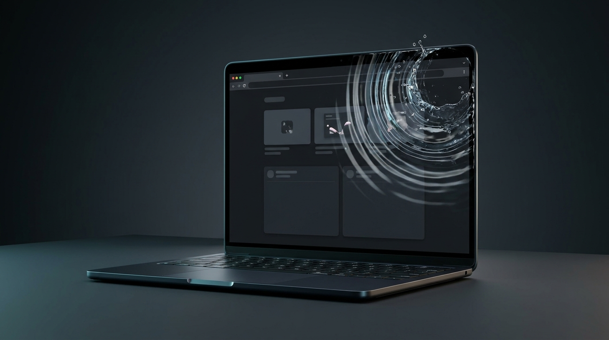
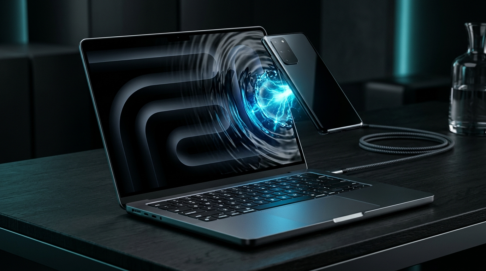
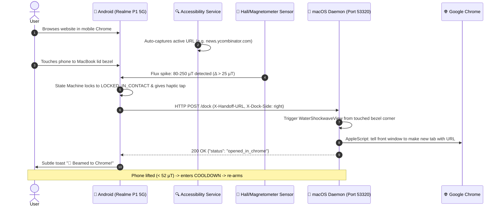

<p align="center">
  
</p>

<h1 align="center">🧲 NOX SNAP</h1>

<p align="center">
  <b>Sub-Millisecond Hardware Magnetic Handoff & Crystalline Water Shockwave Engine</b><br>
  <i>Touch your phone to any MacBook lid magnet to beam your active browser tab into Google Chrome instantly.</i>
</p>

<p align="center">
  <a href="https://github.com/Naveen57990/NoxSnap/releases/latest"></a>
  
  
  
  
  
</p>

---

## ⚡ Direct Download Binaries

<table>
  <tr>
    <td align="center" width="50%">
      <a href="https://github.com/Naveen57990/NoxSnap/releases/download/v2.1/NoxSnap.apk">
        
      </a>
      <br>
      <sub>Compatible with Android 10 to Android 15 (Realme, Samsung, Pixel, OnePlus)</sub>
    </td>
    <td align="center" width="50%">
      <a href="https://github.com/Naveen57990/NoxSnap/releases/download/v2.1/NoxSnap-macOS.zip">
        
      </a>
      <br>
      <sub>Universal Binary for Apple Silicon (M1/M2/M3/M4/M5) & Intel macOS 14+</sub>
    </td>
  </tr>
</table>

---

## 🌊 Visual Preview & Apple-Grade Water Ripple

When your phone makes contact with your MacBook's lid magnet, a **pure liquid water shockwave** radiates from the exact touched bezel edge across your Retina display while your active tab opens in the front window of Google Chrome:

<p align="center">
  <br>
  <i>Crystalline dual-layer harmonic water wavefront expanding smoothly from the touched bezel corner.</i>
</p>

<p align="center">
  <br>
  <i>Hardware snap: Phone makes contact with MacBook lid bezel magnet to trigger instant browser handoff.</i>
</p>

---

## 🌈 Why NoxSnap?

Traditional handoff protocols (Apple AirDrop, Universal Clipboard, Chrome Sync) rely on cloud relays, Bluetooth handshakes, or manual copy-pasting.

**NoxSnap introduces zero-click, zero-cloud physical continuity:**
* 🧲 **True Hardware Neodymium Trigger**: Senses the native magnetic latch magnets embedded in your MacBook's lid bezel ($\ge 80\,\mu\text{T}$). No NFC tags, stickers, or special cases required.
* ⚡ **Live Browser Tab Auto-Capture**: An unobtrusive Android Accessibility Service monitors your active mobile Chrome tab and grabs the URL in real time without touching the clipboard.
* 🌊 **Crystalline Water Shockwave Effect**: Scrubbed of all gaudy neon colors, emoji pills, and text banners. Shows only transparent, specular water ripple wavefronts with viscous fluid deceleration.
* 🛡️ **Physical Contact Immunity**: Multi-tier hysteresis state machine (`ARMED` $\to$ `LOCKED_IN_CONTACT` $\to$ `COOLDOWN`). Zero toggles, zero repeat triggers, zero accidental swapping while resting on the magnet.
* 🎯 **Single Tab Guarantee**: Strict atomic timestamp deduplication ($2.2\,\text{s}$ lock) ensures your beamed URL never opens twice.
* 🚀 **Instant Hotspot & Wi-Fi Auto-Discovery**: Caches host IP with parallel subnet and ARP table probes for instant sub-20ms handoff even after network reconnects.

---

## 🛠️ Architecture & Dataflow



---

## ⚙️ Physical Magnetic State Machine

To prevent the erratic sensor looping common in naive magnetometer apps, NoxSnap implements a strict physics-based hysteresis gate:

| State | Magnetic Field ($\mu\text{T}$) | Description | Action Allowed |
| :--- | :--- | :--- | :--- |
| **`ARMED`** | $< 52\,\mu\text{T}$ | Phone in air or hand; tracks ambient baseline | Ready to trigger dock |
| **`TRIGGER`** | $\ge 80\,\mu\text{T}$ ($\Delta \ge 25$) | Instant physical contact with MacBook bezel | Fires dock handoff once |
| **`LOCKED`** | $\ge 52\,\mu\text{T}$ | Phone resting physically on laptop lid | **Zero triggers (Locked)** |
| **`COOLDOWN`** | $< 52\,\mu\text{T}$ for $800\,\text{ms}$ | Phone physically lifted away from laptop | Re-arms detector safely |

---

## 🚀 Quick Launchers (macOS)

Inside the repository root:
* 👉 **`START_NOXSNAP_MAC.command`**: Launches the silent background macOS receiver (`/Applications/NoxSnap.app`).
* 👉 **`STOP_NOXSNAP_MAC.command`**: Gracefully terminates the background daemon.
* 👉 **`INSTALL_PHONE_APK.command`**: Installs and launches the latest `NoxSnap.apk` on any ADB-connected phone.

---

## 📦 Building from Source

### 🍏 macOS Receiver
* **Requirements**: macOS 14.0+, Xcode Command Line Tools (`swift --version` 6.0+)
```bash
cd NoxSnapMac
./build_mac.sh
open /Applications/NoxSnap.app
```

### 📱 Android Client
* **Requirements**: Android Studio / Gradle 8.9+, JDK 17+, Android SDK 34
```bash
cd NoxSnapAndroid
./gradlew assembleDebug
adb install -r app/build/outputs/apk/debug/app-debug.apk
```

---

## 📊 Technical Comparison

| Feature | Apple Handoff | Pushbullet / AirDroid | Chrome Tab Send | **NoxSnap 🧲** |
| :--- | :---: | :---: | :---: | :---: |
| **Cross-Platform (Android $\to$ Mac)** | ❌ (Apple Only) | ✅ | ✅ | **✅ Full Native** |
| **Physical Hardware Trigger** | ❌ (Menu click) | ❌ (UI Share) | ❌ (Context Menu) | **✅ Bezel Magnet Contact** |
| **Transfer Latency** | $\sim 2-5\,\text{s}$ | $\sim 3-8\,\text{s}$ | $\sim 5-15\,\text{s}$ | **⚡ Sub-100 ms** |
| **Cloud Account Required** | ✅ (iCloud) | ✅ (3rd Party) | ✅ (Google Account)| **❌ 100% Offline LAN** |
| **Visual Animation** | None | Generic Toast | Banner Notification | **🌊 Crystalline Water Wave** |
| **Single Tab Guarantee** | ⚠️ Occasional dupes | ⚠️ Browser dupes | ⚠️ Background tab | **✅ Deduped in Front Window** |
| **Idle CPU Consumption** | OS Native | High (Electron) | Chrome Process | **✅ 0.0% Idle** |

---

## 📄 License

This project is open-source under the **[MIT License](LICENSE)**.  
Designed & Engineered by **[Naveen](https://github.com/Naveen57990)** • Crafted for speed, physical delight, and invisible continuity.
